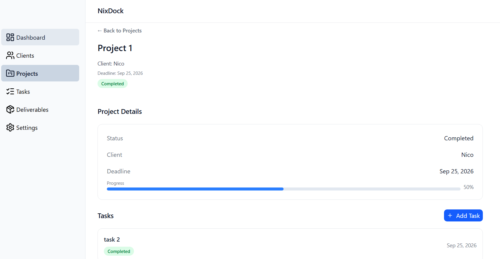
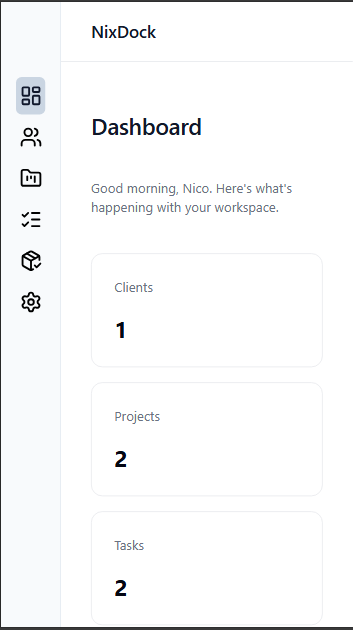

# NixDock

NixDock is a workspace management platform for freelancers and small service businesses. It helps users organize clients, projects, tasks, deadlines, and deliverables in one place.

## Features

- Client management
- Project management with optional client assignment
- Task management and deadline validation
- Deliverable tracking
- Dynamic project progress based on completed tasks
- User authentication with JWT
- User-specific data access and ownership checks
- Input validation and error handling
- Project, task, client, and deliverable relationships
- Responsive interface
- Reusable forms for creating and editing records

## Tech Stack

### Frontend

- React
- React Router
- Tailwind CSS
- Vite
- JavaScript
- Lucide React

### Backend

- Node.js
- Express
- PostgreSQL
- JWT authentication

## Key Implementation Details

- Shared frontend state is managed through the root layout and React Router's `Outlet` context.
- The backend exposes API endpoints for managing application resources.
- PostgreSQL stores application data and enforces relational integrity.
- JWT authentication protects API routes and associates requests with the authenticated user.
- Database queries scope resources to the authenticated user.
- Project progress is calculated dynamically from task completion.
- Project deadlines are checked against associated task deadlines.
- Task and deliverable dates are validated before database operations.
- Project deletion respects database relationships with associated tasks and deliverables.
- Reusable form components support creating and editing records.
- Dynamic routes and URL parameters display individual resource details.

## Tech Stack Overview

- **Frontend:** React, React Router, Tailwind CSS, Vite
- **Backend:** Node.js, Express
- **Database:** PostgreSQL
- **Authentication:** JSON Web Tokens (JWT)

## Getting Started

### Prerequisites

- Node.js
- npm
- PostgreSQL

### Installation

Clone the repository:

```bash
git clone https://github.com/nico-devstudio/nixdock.git
cd nixdock
```

Install the frontend dependencies:

```bash
npm install
```

Install backend dependencies from the backend directory:

```bash
cd backend
npm install
```

### Environment Configuration

Configure the backend environment variables for your PostgreSQL connection and JWT secret. Use the environment variable names expected by your backend configuration.

Do not commit `.env` files, database passwords, or JWT secrets to version control.

### Running the Application

Start the backend from its directory using the development script defined in its `package.json`.

Start the frontend from the project root:

```bash
npm run dev
```

Open the local URL provided by Vite.

Ensure PostgreSQL is running and the backend database has been configured before using the application.

## Screenshots

### Desktop




### Mobile




## Future Improvements

- Production deployment
- Automated tests
- Improved notifications and reminders
- File uploads for deliverables
- Additional workspace and collaboration features
- Enhanced reporting and analytics
