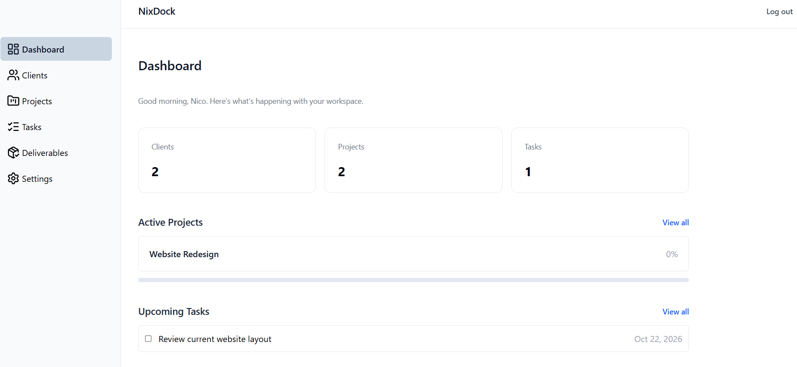
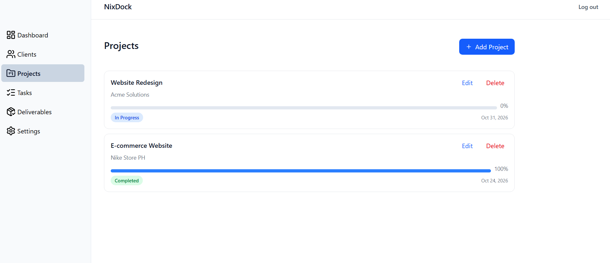
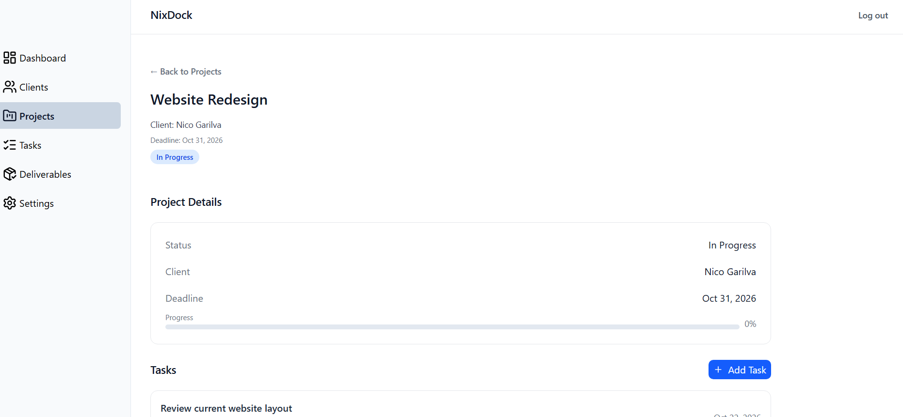
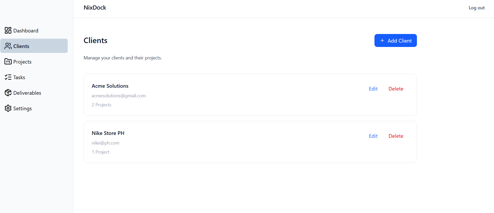
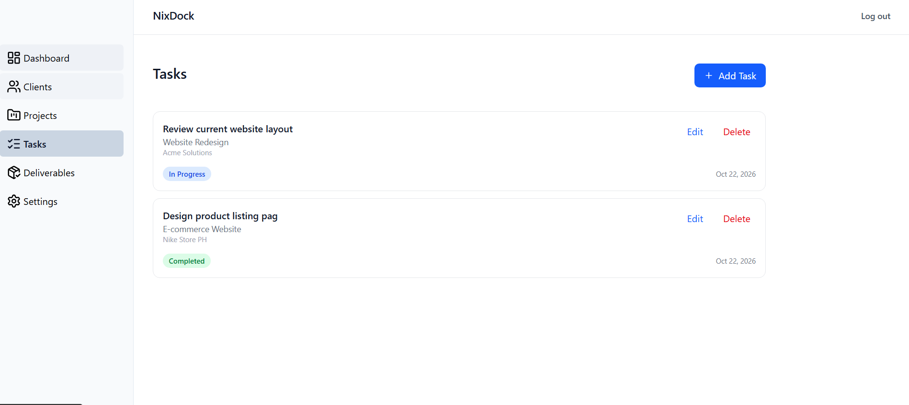
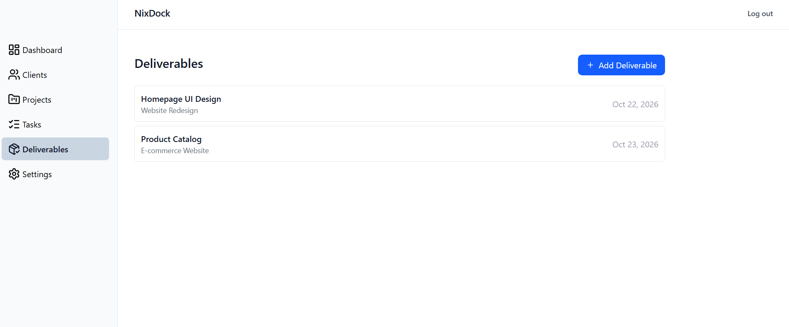
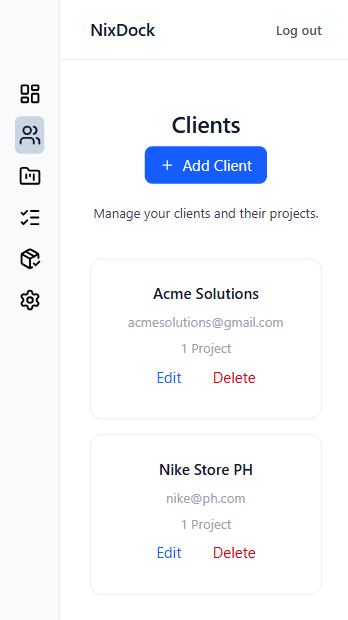

# NixDock

**A workspace management platform for freelancers and small service businesses.**

NixDock helps freelancers organize client relationships and manage projects, tasks, deadlines, and deliverables in one place.

🔗 **Live Demo:** https://nix-dock.vercel.app/

💻 **Repository:** https://github.com/nico-devstudio/NixDock

This project is actively being developed as a full-stack portfolio application.

## The Problem

Freelancers and small service businesses often manage client information, project deadlines, tasks, and deliverables across different tools. This can make it difficult to track progress and keep work organized.

NixDock brings these workflows together in a single workspace, helping users keep track of their clients and the work they deliver.

## Features

- **Authentication:** Register and log in with protected user accounts.
- **Client Management:** Create, view, update, and delete client records.
- **Project Management:** Organize projects, associate clients, and manage project deadlines and status.
- **Task Management:** Create and track tasks associated with projects.
- **Deliverable Management:** Organize project deliverables and their due dates.
- **Progress Tracking:** View project progress based on task completion.
- **Data Validation:** Validate user input and enforce relevant project and deadline constraints.
- **Responsive Interface:** Access the workspace through a modern web interface.

## Screenshots

Dashboard


Projects and project details




Clients


Tasks and deliverables




Mobile


## Tech Stack

### Frontend

- React
- JavaScript
- Vite
- React Router
- Tailwind CSS
- Lucide React

### Backend

- Node.js
- Express
- PostgreSQL
- `pg` for database access
- JSON Web Tokens (JWT) for authentication
- bcrypt for password hashing

### Deployment

- Vercel — frontend
- Render — backend API
- Neon — PostgreSQL database

## Architecture Overview

NixDock uses a client-server architecture.

1. The React frontend renders the user interface and handles navigation and user interactions.
2. The frontend sends HTTP requests to the Express API.
3. Authentication middleware verifies JWTs on protected routes.
4. Controllers handle request validation and coordinate application logic.
5. Service modules perform database operations through PostgreSQL.
6. User-specific queries enforce ownership of clients, projects, tasks, and deliverables.

## Local Development

### Prerequisites

- Node.js and npm
- Git
- A PostgreSQL database

### 1. Clone the repository

```bash
git clone https://github.com/nico-devstudio/NixDock.git
cd NixDock
```

### 2. Install frontend dependencies

From the project root:

```bash
npm install
```

### 3. Configure the frontend

Create a `.env` file in the project root:

```env
VITE_API_URL=http://localhost:3000
```

### 4. Install backend dependencies

```bash
cd backend
npm install
```

### 5. Configure the backend

Create a `backend/.env` file using the environment variable names required by the backend:

```env
PORT=3000
DB_USER=your_postgresql_username
DB_HOST=your_postgresql_host
DB_NAME=your_database_name
DB_PASSWORD=your_database_password
DB_PORT=5432
JWT_SECRET=your_long_random_secret
FRONTEND_URL=http://localhost:5173
```

Replace the example values with your own local configuration. Never commit real credentials or `.env` files.

### Initialize the database

Create a local PostgreSQL database and apply the schema:

```bash
createdb nixdock
psql -d nixdock -f backend/db/schema.sql
```

If your PostgreSQL installation requires an explicit username or host, use the appropriate connection options, such as `-U postgres -h localhost`.

Make sure the `DB_USER`, `DB_HOST`, `DB_NAME`, `DB_PASSWORD`, and `DB_PORT` values in `backend/.env` match your local PostgreSQL configuration.

### 6. Start the backend

From the `backend` directory:

```bash
npm run dev
```

### 7. Start the frontend

Open a second terminal at the repository root:

```bash
npm run dev
```

Open the local URL printed by Vite in your browser.

## Available Scripts

### Frontend

| Command           | Description                          |
| ----------------- | ------------------------------------ |
| `npm run dev`     | Start the Vite development server    |
| `npm run build`   | Build the production frontend        |
| `npm run preview` | Preview the production build locally |
| `npm run lint`    | Run ESLint                           |

### Backend

| Command       | Description                    |
| ------------- | ------------------------------ |
| `npm run dev` | Start the backend with Nodemon |
| `npm start`   | Start the backend with Node.js |

## Production Build and Lint

Run these commands from the project root:

```bash
npm run lint
npm run build
```

The backend currently has no automated test suite configured.

## Security Notes

- Passwords are hashed with bcrypt rather than stored as plain text.
- Protected API routes require a valid JWT.
- Database queries scope records to the authenticated user.
- Secrets and database credentials must be supplied through environment variables.

## What I Learned

Building NixDock gave me practical experience with React application structure, REST API development, authentication, relational database design, server-side validation, user-level data authorization, and deploying a full-stack application.

The project also helped me understand how frontend components, backend controllers and services, and database relationships work together in a real application.

## Future Improvements

- Automated integration and end-to-end tests
- Improved accessibility and responsive behavior
- Additional workflow and productivity features

---

Built as a full-stack portfolio project by Nico.
